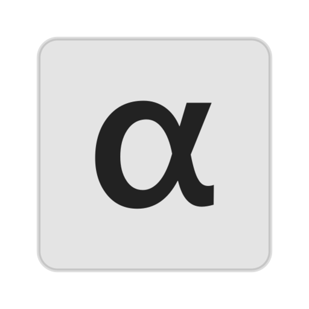

<div align="center">



# Alpha

**Desktop GUI for the [pi](https://github.com/earendil-works/pi) coding agent**

Electron · React 19 · TypeScript

</div>

---

Alpha — минималистичное десктопное приложение поверх агента **pi**. pi встроен внутрь: свой рантайм, свои конфиги, никакой системной установки. Всё локально, ключи API остаются на твоей машине.

## Возможности

- 💬 Стриминг ответов, развёрнутые tool calls, fork и поиск по чатам
- 🧠 **Режимы**: Агент, План (read-only до одобрения), Дебаг (протокол отладки + ошибка в контексте), Помощник, Быстрый
- 🧩 **Моды** вместо расширений: темы, GUI-панели, ядро-хуки
- 📚 **Память проекта** и база знаний: автоматически подставляются в промпт, карта кодовой базы `PROJECT.md` строится в один клик
- 🔀 Параллельные фоновые чаты, git worktree, ревью diff и откат чекпоинтами
- 🤖 Субагенты, веб-поиск, собственные инструменты из коробки
- 🎨 12 встроенных тем, шрифты в комплекте, RU/EN интерфейс

## Установка (Arch Linux)

```bash
sudo pacman -Sy && sudo pacman -S alpha
alpha
```

## Сборка из исходников

```bash
npm install
npm run dev        # разработка с горячей перезагрузкой
npm run typecheck  # типы main + renderer
npm run build      # сборка в out/
npm run smoke      # сборка + дымовой тест главного процесса
```

## Сборка AppImage

```bash
npm install
npm run build
npx electron-builder --linux AppImage
# результат: dist/Alpha-<version>.AppImage
```

AppImage — переносимый бинарник, ставится без прав:

```bash
chmod +x dist/Alpha-*.AppImage
./dist/Alpha-*.AppImage
```

## Структура

| Путь | Что внутри |
|---|---|
| `src/main` | Electron main: IPC, встроенный pi, моды, режимы, ревью |
| `src/renderer` | React UI: лента, панели, настройки, шрифты |
| `src/preload` | Мост main ↔ renderer |
| `src/shared` | Общие типы IPC-контракта |
| `icons/` | SVG-иконки (`currentColor`) |
| `tests/` | CDP-проверка рендерера |
